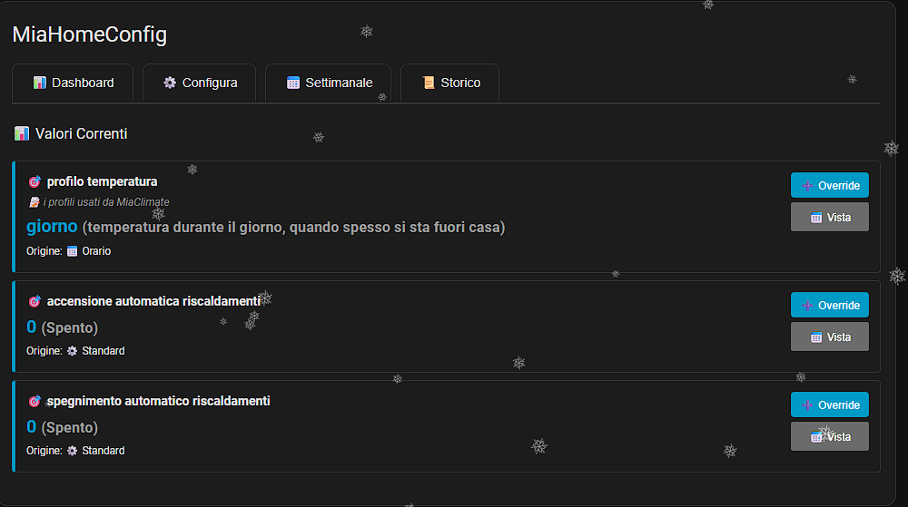

# Mia Config for Home Assistant

[](https://github.com/hacs/integration)
[](https://GitHub.com/abiale85/MiaConfig/releases/)
[](https://GitHub.com/abiale85/MiaConfig/issues/)
[](https://github.com/abiale85/MiaConfig/blob/main/LICENSE)

[🇮🇹 Italian](README.md) | 🇬🇧 **English**

A custom component for Home Assistant that manages dynamic configurations with values that automatically change based on temporal and time rules with an advanced priority system.

> ### 🆕 New in 2.3.9 — Dashboard widgets
> - **[Auto/Manual widget](#automanual-widget)** (`mia-config-widget`): manually force a value from any dashboard for a chosen time (30 min, until 22:00, until the next automatic change…), then it goes back to automatic on its own. Row, tile and full card layouts.
> - **[Temporary override of any entity](#temporary-override-of-any-entity)** (`mia-config-entity-widget`): turn on a light, raise the thermostat or open a cover for a while; when it expires Mia Config restores the previous value, even across restarts.
> - **[Override shortcuts](#override-shortcuts)** (`mia-config-shortcuts`): timed overrides with one tap.
> - **[Natural-language assistant](#natural-language-assistant-ai-task)** (`mia-config-assistant`): type *"heating on until 22"* and Home Assistant's AI fills in the popup for you to confirm.
> - **Automatic Lovelace resources**: card and widgets register themselves, nothing to set up by hand.
>
> Full list in the [CHANGELOG](CHANGELOG.md).

## Features

- **Multi-Instance**: Support for separate configurations for multiple homes/environments
- **Standard Configurations**: Default values with customizable priority system
- **Time Configurations**: Values valid in specific date intervals with priority
- **Schedule Configurations**: Values valid in daily time slots with weekday selection and priority
- **Conditional Configurations**: Dynamic values based on entity states
- **Advanced Priority System**: Each configuration has numerical priority (1 = highest, 99 = lowest)
- **Dynamic Sensors**: Each configuration is exposed as a sensor in Home Assistant
- **Event Prediction**: Attributes with ISO timestamps of next value changes
- **Weekly Lookahead**: Default prediction window set to 7 days (configurable via options)
- **Complete Services**: API for managing configurations via automations or scripts
- **Complete UI Interface**: Lovelace card with dashboard, weekly view, management, and history
- **Dashboard Widgets**: Auto/Manual override with expiry, override shortcuts and a natural-language assistant, usable on any dashboard
- **Temporary Override of Any Entity**: set a value for a while and get the previous one back on expiry (optionally re-applied if someone changes it)
- **AI Assistant**: natural-language requests through Home Assistant AI Task, always confirmed before applying
- **Isolated Database**: Each instance has its own separate SQLite database
- **Complete History**: Modification history with pagination and restore

## Installation

### Method 1: Manual Installation

1. Copy the `custom_components/mia_config` folder to your Home Assistant `custom_components` folder
   - **Note**: The folder already includes necessary files in the `www/` subfolder
2. Restart Home Assistant

### Method 2: HACS (Recommended)

1. Open HACS
2. Go to "Integrations"
3. Click the three dots in the top right → "Custom repositories"
4. Add: `https://github.com/abiale85/MiaConfig` (Category: Integration)
5. Search for "Mia Config"
6. Click "Install"
7. Restart Home Assistant

## Configuration

### Adding via UI (Recommended)

1. Go to **Settings** → **Devices & Services**
2. Click **Add Integration**
3. Search for **Mia Config**
4. Enter a name for the database (e.g., "MiaHomeConfig" for main home)
5. Confirm

### Manual Configuration (Advanced)

Add to your `configuration.yaml`:

```yaml
mia_config:
  - db_name: "mia_home_config"
    scan_interval: 60
    lookahead_hours: 48
    lookback_hours: 24
    cleanup_days: 90
    retention_days: 365
    max_history_per_name: 1000
    min_history_per_name: 10
```

## Quick Start

### 1. Add the Lovelace Card

```yaml
type: custom:mia-config-card
entity: sensor.mia_home_config_active_configs
```

### 2. Create Your First Configuration

Via UI:
1. Open the Mia Config card
2. Click "Add Configuration"
3. Enter name (e.g., "house_temperature")
4. Set default value (e.g., "20")
5. Save

Via Service:
```yaml
service: mia_config.set_standard_config
data:
  setup_name: "house_temperature"
  setup_value: "20"
  priority: 99
  description: "Default house temperature"
```

### 3. Add Time-Based Override

Example: Higher temperature from 6:00 to 22:00:

```yaml
service: mia_config.set_schedule_config
data:
  setup_name: "house_temperature"
  setup_value: "22"
  valid_from_ora: 6.0
  valid_to_ora: 22.0
  days_of_week: [0, 1, 2, 3, 4]  # Monday to Friday
  priority: 50
```

### 4. Use in Automations

```yaml
automation:
  - alias: "Set Thermostat Based on Config"
    trigger:
      - platform: state
        entity_id: sensor.house_temperature
    action:
      - service: climate.set_temperature
        target:
          entity_id: climate.living_room
        data:
          temperature: "{{ states('sensor.house_temperature') | float }}"
```

## Dashboard Widgets

Lovelace resources for the card and all widgets are managed by the integration (created, versioned with `?v=`, duplicates removed): you don't need to register them by hand. All widgets are available in the card picker.

### Auto/Manual widget

`custom:mia-config-widget` (**Mia Config Widget** in the card picker) manually forces a value of a Mia Config sensor from any dashboard, independently of the main card.

| `layout` | Look |
|---|---|
| `row` (default) | Same size as an entity row. In **Auto** it has a dashed grey outline (a switch that is on shows a blue dot); in **Manual** a solid orange outline. Tap the row to open the popup and go back to Auto |
| `tile` | Compact tile with value, status and how long the value has been active |
| `card` | Full card: Auto/Manual selector, always-visible value controls, expiry |

Forcing a value opens a **For how long** popup: 30 min, 1 h, 2 h, 4 h, *until the next automatic change*, *until HH:MM* (tomorrow if already past), *date and time* or *no expiry*.

```yaml
type: custom:mia-config-widget
entity: sensor.mia_config_temperatura_clima
layout: row                # row | tile | card
name: Temperature          # optional
icon: mdi:thermometer      # optional
control: auto              # optional: auto | boolean | select | number | text
min: 5                     # optional, for numbers
max: 30
step: 0.5
unit: °C
durations: [15, 30, 60, 180]   # optional: quick durations in minutes
show_values: false         # optional: show values instead of their descriptions
```

With `control: auto` the type is detected: a switch if the **Valid Values** are exactly `0` and `1`, a dropdown for other Valid Values, a switch for `true/false` or `on/off`, a number if numeric, otherwise text. The override uses a reserved priority (`0`), higher than any selectable one, and returns to Auto on expiry. In the sections view, a `row` widget resized to 2+ rows shows the value on its own line with how long it has been active (taken from the recorder history, so it survives restarts). The icon opens the entity history.

### Temporary override of any entity

`custom:mia-config-entity-widget` (**Mia Config Forzatura entità** in the card picker) works like the Auto/Manual widget, but on **any** Home Assistant entity: pick a value and how long to keep it; on expiry Mia Config restores the previous value. Same `row`, `tile` and `card` layouts (the card also lists recent overrides). Mia Config's own sensors are rejected: use `mia-config-widget` for those.

```yaml
type: custom:mia-config-entity-widget
entity: climate.living_room
layout: row
enforce: false             # optional: re-apply the forced value if someone changes it
restore_to: original       # optional: original | last_manual
```

| Domain | What is forced |
|---|---|
| `switch`, `light`, `fan`, `input_boolean`, `automation`, `siren`, `humidifier`, `remote` | on/off (lights also get their brightness back) |
| `input_number`, `number` | numeric value |
| `input_select`, `select` | option |
| `input_text`, `text` | text |
| `climate`, `water_heater` | target temperature |
| `cover`, `valve` | position 0-100 if supported, otherwise open/closed |
| `lock` | locked/unlocked |

Active overrides and history are stored in the instance database (`forzature_entita` table, included in backups) and rescheduled after a restart; if the entity is unavailable at restore time, Mia Config retries every minute for an hour. The `sensor.forzature_entita_<instance>` sensor lists active overrides.

```yaml
# In an automation: heating at 23 °C for 2 hours
action: mia_config.set_entity_override
data:
  entity_id: climate.living_room
  value: "23"
  duration: "02:00:00"
  enforce: true
  restore_to: original
```

### Override shortcuts

`custom:mia-config-shortcuts` (**Mia Config Scorciatoie**) adds timed overrides with one tap and lists active or scheduled overrides with ✕ to delete them; **Custom** opens the full override popup.

```yaml
type: custom:mia-config-shortcuts
entity: sensor.mia_config_profilo_temperatura
priority: 1
shortcuts:
  - name: Comfort
    value: sera
    duration: 120           # minutes from now
    icon: mdi:sofa
  - name: Eco
    value: eco
    until: "23:30"
  - name: Early night
    value: notte
    from: "21:00"
    duration: 180
    priority: 2
show_custom: true
show_active: true
```

### Natural-language assistant (AI Task)

Type what you want, e.g. *"heating on until 22"* or *"tomorrow 18 to 20 eco profile with priority 2"*: the LLM configured in Home Assistant interprets it and opens the popup **pre-filled** for you to confirm. Nothing changes without confirmation. Requires Home Assistant 2025.7+ and an AI integration set up as **AI Task**. Available at the top of the main card dashboard and as `custom:mia-config-assistant`.

```yaml
type: custom:mia-config-assistant
setup_name: profilo_temperatura        # optional: limit to one configuration
ai_task_entity: ai_task.openai_ai_task # optional
```

### Main card popups

On the main card dashboard every configuration has **🖐️ Manual** (timed manual override), **➕ Override** (timed override with value, start, duration and priority) and, for standard-only configurations, **✏️ Value**.

## Configuration Types

### 1. Standard Configuration
Base values with priority. Multiple standard configs can coexist; the one with highest priority (lowest number) wins.

```yaml
service: mia_config.set_standard_config
data:
  setup_name: "alarm_mode"
  setup_value: "home"
  priority: 99
  description: "Default alarm mode"
```

### 2. Schedule Configuration
Overrides during specific time slots and weekdays.

```yaml
service: mia_config.set_schedule_config
data:
  setup_name: "alarm_mode"
  setup_value: "away"
  valid_from_ora: 8.0    # 8:00
  valid_to_ora: 18.0     # 18:00
  days_of_week: [0, 1, 2, 3, 4]  # Mon-Fri
  priority: 50
```

**Special Cases**:
- `valid_from_ora == valid_to_ora`: Active 24 hours (e.g., 8.0 - 8.0 = always active on selected days)
- `valid_to_ora < valid_from_ora`: Crosses midnight (e.g., 22.0 - 6.0 = from 22:00 to 6:00 next day)

### 3. Time Configuration
Overrides during specific date ranges.

```yaml
service: mia_config.set_time_config
data:
  setup_name: "alarm_mode"
  setup_value: "vacation"
  valid_from_date: "2026-08-01 00:00"
  valid_to_date: "2026-08-31 23:59"
  priority: 10
```

**Optional Filters**:
- `valid_from_ora`, `valid_to_ora`: Active only during time slots
- `days_of_week`: Active only on certain days

### 4. Conditional Configuration
Overrides based on other entity states.

```yaml
service: mia_config.set_conditional_config
data:
  setup_name: "house_temperature"
  setup_value: "18"
  conditional_config: "presence_mode"
  conditional_operator: "=="
  conditional_value: "away"
  priority: 30
```

**Supported Operators**: `==`, `!=`, `>`, `<`, `>=`, `<=`

## Priority System

Priorities determine which configuration wins when multiple are valid:
- **1-9**: Maximum priority (e.g., emergency overrides)
- **10-49**: High priority (e.g., vacations, special events)
- **50-89**: Normal priority (e.g., daily schedules)
- **90-99**: Low priority (e.g., standard configurations)

**Example**:
```
Standard "20" (priority 99)
Schedule "22" 6:00-22:00 (priority 50)
Time "18" vacation (priority 10)
```
Result: During vacation → "18", otherwise during 6:00-22:00 → "22", otherwise → "20"

## Advanced Features

### Multi-Instance

You can create multiple instances for different environments:

```yaml
mia_config:
  - db_name: "main_home"
    scan_interval: 60
  - db_name: "vacation_home"
    scan_interval: 120
  - db_name: "office"
    scan_interval: 300
```

Each instance has isolated sensors and databases.

### Backup and Restore

#### Create Backup
```yaml
service: mia_config.backup_database
data:
  entity_id: sensor.mia_home_config_active_configs
  backup_name: "pre_update_backup"
```

#### Restore from Backup
```yaml
service: mia_config.restore_database
data:
  entity_id: sensor.mia_home_config_active_configs
  backup_name: "pre_update_backup"
```

### History and Audit

All changes are recorded in history with:
- Timestamp
- Configuration type
- Values
- Operation (created, modified, deleted)

View history via:
- UI card (History tab)
- Service `mia_config.get_history`

### Weekly View

The card includes an interactive weekly view that shows:
- All active configurations
- Time slots
- Overlaps
- Click on bars for details

## Sensor Attributes

Each sensor exposes these attributes:

```yaml
friendly_name: "house_temperature"
current_value: "22"
current_priority: 50
current_type: "schedule"
valid_from: "2026-01-06T06:00:00+01:00"
valid_to: "2026-01-06T22:00:00+01:00"
next_change_time: "2026-01-06T22:00:00+01:00"
next_change_value: "20"
next_change_type: "standard"
all_configs: [...]  # All active configurations
```

## Complete Services

### Management Services
- `set_standard_config`: Set standard configuration
- `set_schedule_config`: Set schedule override
- `set_time_config`: Set temporal override
- `set_conditional_config`: Set conditional override
- `update_standard_config`: Update existing configuration
- `delete_config`: Delete configuration
- `delete_single_config`: Delete specific configuration by ID
- `toggle_config`: Enable/disable configuration
- `set_manual_override` / `clear_manual_override`: Timed manual override of a configuration
- `set_entity_override` / `clear_entity_override`: Temporary override of any entity
- `interpret_request`: Turn a natural-language request into a proposal (not applied)

### Query Services
- `get_configurations`: Get all configurations
- `get_history`: Get modification history
- `get_entity_override_history`: Get entity override history
- `get_valid_values`: Get all valid values for dropdown lists
- `simulate_schedule`: Simulate weekly schedule

### Backup Services
- `backup_database`: Create backup
- `restore_database`: Restore from backup
- `list_backups`: List available backups
- `delete_backup`: Delete specific backup
- `delete_all_backups`: Delete all backups

### Maintenance Services
- `cleanup_history`: Clean old history
- `import_config`: Import configurations from YAML
- `export_config`: Export configurations to YAML

## Troubleshooting

### Sensors not updating
- Check scan_interval in configuration
- Verify configurations are enabled
- Check Home Assistant logs

### Conflicts between configurations
- Review priorities
- Use weekly view to visualize overlaps
- Check history for recent changes

### Card not appearing
- Clear browser cache (Ctrl+F5)
- Verify `www/mia-config-card.js` exists
- Check browser console for errors

## Development

### Testing
```bash
# Run tests
pytest tests/

# Check coverage
pytest --cov=custom_components/mia_config tests/
```

### Contributing
Contributions are welcome! Please:
1. Fork the repository
2. Create a feature branch
3. Make your changes
4. Submit a pull request

## License

MIT License - see [LICENSE](LICENSE) file

## Support

- **Issues**: https://github.com/abiale85/MiaConfig/issues
- **Discussions**: https://github.com/abiale85/MiaConfig/discussions
- **Documentation**: https://github.com/abiale85/MiaConfig/wiki

## Credits

Developed by [@abiale85](https://github.com/abiale85)

## Changelog

See [CHANGELOG.md](CHANGELOG.md) for complete version history.

## Screenshots




---

**Made with ❤️ for the Home Assistant community**
